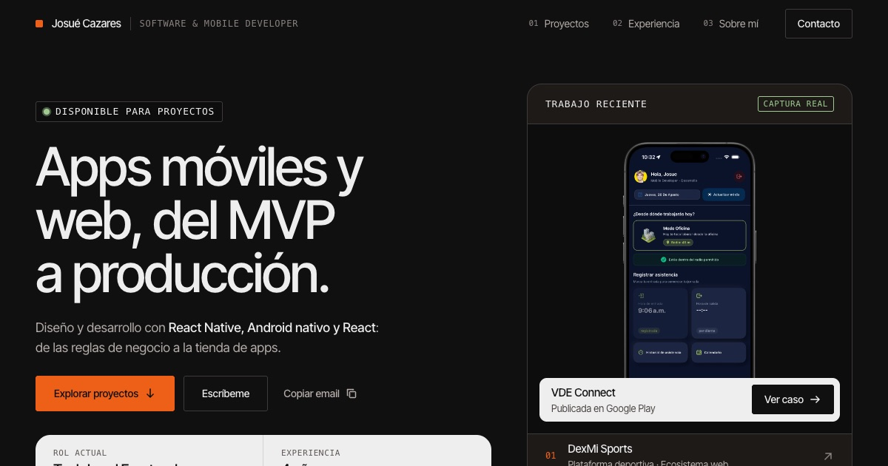

# Josué Cazares · Portafolio

**Apps móviles y web, del MVP a producción.**

Portafolio de **Josué Cazares**, Tech Lead Frontend en VDE Suite LATAM. Muestra los proyectos como productos reales: cada uno con capturas, rol, stack, una funcionalidad distintiva y enlaces para verlo funcionando.

🔗 **Sitio:** [chubibi.github.io/myself](https://chubibi.github.io/myself/)



---

## Contenido

| # | Sección | Qué muestra |
|---|---|---|
| — | **Hero** | Propuesta de valor, disponibilidad, datos clave y acceso rápido a los proyectos |
| 01 | **Proyectos** | DexMi Sports · VDE Connect (caso de estudio) · CUVA · J2R Studio |
| 02 | **Experiencia** | Línea de tiempo (VDE Suite, BAACC, Elektra) y stack principal por área |
| 03 | **Sobre mí** | Perfil, dos carreras (Ingeniería en TI + Idiomas), capacidades y certificaciones |
| 04 | **Contacto** | Canales directos y formulario |

### Proyectos destacados

- **DexMi Sports:** ecosistema digital de fútbol y básquetbol. Tech Lead Frontend del MVP.
- **VDE Connect:** app de asistencia laboral [publicada en Google Play](https://play.google.com/store/apps/details?id=com.vde.vdeconnect). Incluye una demo con pestañas sobre capturas reales.
- **CUVA:** sitio institucional responsivo. Proyecto freelance.
- **J2R Studio:** catálogo de moda con guía de tallas en 3D. Proyecto propio, en desarrollo.

---

## Stack

- **React 18** + **Vite**
- **CSS Modules** con tokens globales (sin frameworks de UI)
- **Inter Tight** (Google Fonts) y fuente monoespaciada del sistema
- Despliegue en **GitHub Pages** (`gh-pages`)

## Diseño: sistema Dispatch

Estética *industrial product showcase*: superficies oscuras, paneles claros, acentos controlados y metadatos técnicos.

| Token | Valor | Uso |
|---|---|---|
| `--night-floor` | `#101010` | Fondo principal |
| `--carbon-well` | `#1D1A18` | Paneles secundarios |
| `--bone` | `#EEEEEE` | Cards claras y texto principal |
| `--beacon-orange` | `#EE6018` | CTA e indicadores activos |
| `--charge-green` | `#A0CA92` | Estados positivos |
| `--divider` | `#3D3A39` | Bordes de 1 px |

Los tokens de color, tipografía, espaciado (múltiplos de 8), radios y animación están en [`src/styles.css`](src/styles.css).

---

## Estructura

```
src/
├── data/           # Contenido editable: proyectos, experiencia, perfil, formación
├── components/     # Sistema reutilizable: CTAButton, StatusIndicator, SectionLabel,
│                   # ProjectFeature, ProjectMeta, ProjectMedia, MetricDisplay
├── views/          # Secciones: NavBar, Body (Hero), Work, Experience, About, Contact, Footer
├── utils/          # Helpers (rutas de assets)
└── styles.css      # Tokens y estilos base
public/
├── work/           # Capturas optimizadas (WebP)
├── mockups/        # Marcos de iPhone y MacBook
└── about/          # Foto, logo y certificado
```

### Actualizar contenido

El contenido está separado de la presentación. Para agregar o editar información no hace falta tocar componentes:

- Proyectos → [`src/data/projects.js`](src/data/projects.js)
- Experiencia y stack → [`src/data/experience.js`](src/data/experience.js)
- Formación y certificaciones → [`src/data/about.js`](src/data/about.js)
- Contacto y navegación → [`src/data/profile.js`](src/data/profile.js)

---

## Desarrollo

```bash
npm install
npm run dev       # servidor local
npm run lint      # ESLint
npm run build     # build de producción en /dist
npm run deploy    # build + publicación en GitHub Pages
```

## Calidad

- **Responsive mobile-first:** validado de 320 px a 1920 px.
- **Accesibilidad:**
  - HTML semántico y un solo H1.
  - Foco visible y navegación completa con teclado.
  - Pestañas con patrón WAI-ARIA.
  - Contraste WCAG AA.
  - Respeta `prefers-reduced-motion`.
- **Rendimiento:**
  - Imágenes WebP con carga diferida y dimensiones reservadas.
  - El widget de WhatsApp se carga aparte, cuando el navegador queda libre.
- **SEO:** metadatos, Open Graph con imagen de portada y datos estructurados (`Person`).
- **Contenido honesto:** solo capturas reales y métricas con fuente citada.

---

© Josué Cazares · [LinkedIn](https://linkedin.com/in/josué-isaías-cazares-pérez-2697481b7/) · [GitHub](https://github.com/chubibi)
